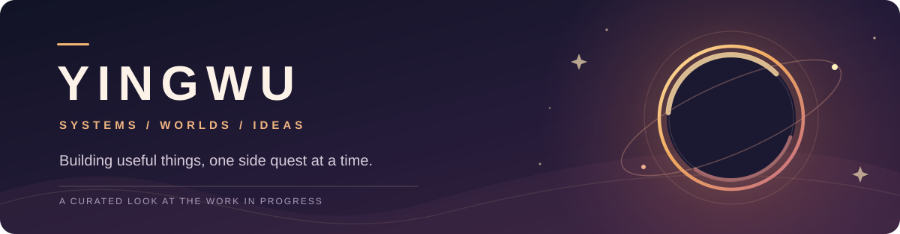
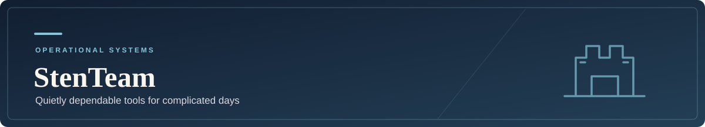

  

  <strong>Curious questions. Very serious engineering. A wildly unreasonable number of side quests.</strong>

  <a href="#-the-short-version">Hello</a> &nbsp;·&nbsp;
  <a href="#-things-ive-used">Toolkit</a> &nbsp;·&nbsp;
  <a href="#-the-things-ive-built">Projects</a> &nbsp;·&nbsp;
  <a href="#-behind-the-scenes">Behind the scenes</a>

---

## ✦ The short version

**Hi, I'm Yingwu! 🦜**

I specialize in making **ridiculously complicated things look suspiciously simple**.

The ideal result? Someone presses a button, everything works, and nobody has to know about the contingency plans, safety checks and weeks of *"okay, but what if this happens?"* behind it.

My projects tend to begin with *"I wonder if that's possible..."* and rapidly become a much larger engineering exercise than originally advertised. Sometimes they're useful. Sometimes they're gloriously silly. Frequently they're both.

## ✦ Things I've used

Not a list of everything I claim to have mastered: these are technologies, platforms and approaches that actually appear in the work.

| Area | Tools and technologies |
| :--- | :--- |
| ☁️ **Cloudflare** | `Workers` `Pages` `D1` `Durable Objects` `KV` |
| 💻 **Web and scripting** | `JavaScript` `HTML` `CSS` `SQL` `Google Apps Script` `LSL / Second Life` |
| 📊 **Office and operations** | `Excel` `Google Sheets` `Microsoft Office` `Slack` `Webhooks` |
| 🔧 **Development and delivery** | `GitHub` `GitHub Actions` `Version control` `Automated checks` `Release documentation` |
| 🤝 **AI-assisted development** | `ChatGPT` `Research` `Implementation support` `Debugging` `Testing` `Documentation` |

> [!NOTE]
> This is a practical-toolkit inventory, not a certification list. I care much more about whether something works, can be understood and can be maintained than whether its buzzwords look impressive.

> [!WARNING]
> **DATA MISSING — TOOLKIT REVIEW:** Which additional Office, Slack, streaming, design, media, analytics or deployment tools should be shown? Which entries should be downplayed or removed?

---

## ✦ The things I've built

**Three project families. Many projects underneath them. A frankly unreasonable number of components below those.**

The hierarchy matters more than the repository count: one private codebase can power numerous independent applications, products and interfaces.

### 01 · StenTeam

**The premise:** day-to-day work should not require a degree in deciphering spreadsheets.

A connected suite of operational tools that makes information easier to find, routine actions easier to complete and complicated processes easier to run reliably. The interfaces are intended to be uncomplicated; the infrastructure behind them very much isn't.

**The system at a glance:**

`Hub Portal` · `Check-in` · `Daily Routine` · `Operational dashboards` · `Data bridge` · `Quality checks` · `QR tools` · `Print tools` · `Audits` · `Workflow integrations`

<strong>EXPAND THE STENTEAM SYSTEM MAP · Applications and components</strong>

 

| Application / family | What it contributes |
| :--- | :--- |
| **STHP — StenTeam Hub Portal** | The unified, role-aware workplace interface and daily operating experience. |
| **STDB — Data Bridge** | Controlled connections between familiar operational spreadsheets and the newer interface. |
| **STQI — Quality & Integrity** | Checks, status visibility and mechanisms for keeping operational information dependable. |
| **STOD — Operations Dashboard** | Focused operational reporting and current/historical overviews. |
| **STQR — QR Services** | QR generation and supporting scanning/diagnostic tools. |
| **STPO — Print & Output** | Generation and handling of practical printable operational documents. |
| **STAC — Audit Checklist** | Structured, recurring operational audit support. |
| **Check-in, Daily Routine & Lekkerland** | Daily operational workflows, editing interfaces and status handling. |
| **Slack & webhooked workflows** | Integrations connecting existing workplace processes with the broader system. |
| **Shared foundations** | Authentication, permissions, synchronization, validation, monitoring, fallbacks and release discipline. |

**Level 0:** StenTeam → **Level 1:** Hub and companion systems → **Level 2:** Operational screens, integrations, safeguards and background services.

Different components have different release states; listing a system here does **not** mean every feature is publicly available or production-ready.

> [!WARNING]
> **DATA MISSING — STENTEAM COUNT:** Verify the number of distinct applications, major modules, workflows, integrations and operational screens. Also confirm which subsystem names/descriptions may be mentioned publicly. **DO NOT TURN AN UNVERIFIED COUNT INTO A CLAIM.**

### 02 · Azalea Antiquary

**The premise:** virtual worlds should reward curiosity, creativity and the occasional extremely unnecessary level of engineering.

An umbrella for Second Life experiences, creator utilities, store systems and experiments. **Second World belongs here**: it's a major flagship project, not an unrelated fourth project family.

**The family at a glance:**

`Second World` · `Creator systems` · `Dynamic Display` · `Commission Works` · `Parrot's Plunder` · `Daily Affirmations` · `Store-owner tools` · `Cabinet of Minor Nonsense`

<strong>SECOND WORLD · Flagship exploration and mapping platform</strong>

 

A large-scale attempt to make the geography and discoveries of Second Life more explorable. Its components cover collecting world evidence, assembling a useful atlas, and building tools around the information — all while being explicit about what is known, outdated or unverified.

| Level 2 component | Focus |
| :--- | :--- |
| **Collective Atlas** | A geographic view of the Second Life world and its changing landscape. |
| **Wayfinder** | In-world navigation and exploration. |
| **Research Stations / Surveyors** | Structured observation and mapping work. |
| **Hivemind & diagnostics** | Research visibility, analysis and quality checks. |
| **Indexing & world snapshots** | The infrastructure that turns observations into useful geographic knowledge. |
| **Research experiments** | Investigating more advanced ways to support discovery, separate from the core atlas experience. |

**Public example:** [Explore the Collective Atlas](https://yingwuazalea.pages.dev/SecondWorld)

<strong>CREATOR SYSTEMS · Build, display and preserve things</strong>

 

| Project | Focus |
| :--- | :--- |
| **Dynamic Display Builder & Catalogue** | A design-and-display system with a structured catalogue and creator-facing tools. |
| **Creator Desk** | Presentation and creation tools with deliberate visual consistency. |
| **The Commission Works** | Projects, creative commissions and their supporting workflow. |
| **Store-owner scripts** | Behind-the-scenes utilities that support a Second Life creator's work. |

**Level 0:** Azalea Antiquary → **Level 1:** Creator systems → **Level 2:** Product tools, catalogues, displays and supporting services.

<strong>GAMES, ODDITIES & SMALLER PRODUCTS · The wonderfully unnecessary department</strong>

 

- **Parrot's Plunder** — a playful Second Life experience with real systems behind the fun.
- **The Daily Affirmation Programme** — proof that even a tiny, cheerful idea can receive an alarming amount of polish.
- **Cabinet of Minor Nonsense** — a home for smaller products, experiments and delightful diversions.
- **Other Azalea products** — a larger inventory to be audited before presenting exact numbers.

> [!WARNING]
> **DATA MISSING — AZALEA PRODUCT AUDIT:** Confirm the number of distinct Store Owner Scripts, Cabinet of Minor Nonsense products, games, creator tools and Second World subproducts. **A catalogue design, a product, an installation and a source-code revision are NOT interchangeable units.** Counts and release statuses must be checked before publishing.

### 03 · Personal Projects

**The premise:** if a better personal tool could exist, why not accidentally build an entire system for it?

A collection of projects for organizing life, tracking interests, supporting streaming and making personal data genuinely usable. Not all of it is public — nor should it be.

**The family at a glance:**

`Media` · `Movies & TV` · `Subscriptions` · `Bowling` · `Streaming catalogue` · `Personal dashboards` · `Yingwu Nova`

<strong>EXPAND PERSONAL PROJECTS · Utilities, streaming and creative work</strong>

 

| Family | Example projects |
| :--- | :--- |
| **Media & collections** | Movies, TV, catalogue and history tools. |
| **Subscriptions & social history** | Personal history and subscription overviews. |
| **Bowling** | Session records, scores, comparisons and progress over time. |
| **Streaming tools** | Streaming catalogue, stream-related utilities and supporting organization. |
| **Personal dashboards** | Small web interfaces that turn complicated personal records into usable views. |
| **Yingwu Nova** | Character identity, VTuber assets, illustrations and an extensive visual design workflow. |
| **Other experiments** | The little tools that usually begin with *"surely this won't be complicated..."* |

**Public example:** [Bowling overview](https://yingwuazalea.pages.dev/yingwu/bowling) · [Social history](https://yingwuazalea.pages.dev/yingwu/social)

> [!WARNING]
> **DATA MISSING — PERSONAL CATALOGUE:** Verify how many distinct streaming tools, media utilities, dashboards and Nova asset families belong here. Identify which are suitable for public description and which must remain private. Confirm whether a public Media demo exists.

> [!WARNING]
> **PUBLIC LINK CHECK REQUIRED:** The Second World, Bowling and Social History URLs above are documented in the project source, but their current availability to an **unauthenticated visitor** has not yet been independently verified for this profile. Check each before treating it as a confirmed public showcase.

---

## ✦ Behind the scenes

### From spreadsheet gremlinry to independent systems

Long before today's AI coding assistants existed, I was already building things.

It often started in **Excel**, then expanded into increasingly elaborate spreadsheets, automations, workflows and tools to solve problems that ordinary software didn't quite handle the way I wanted.

Some of those early solutions were decidedly unconventional. *Gremlin Excel engineering* is probably a fair description. But the underlying habit was already there: understand the problem, design something practical, keep improving it and make it useful for the people actually doing the work.

My background in day-to-day operations gives me a useful perspective: **the people using software should not have to think like the person who built it**. When something looks easy, that is often the result of very deliberate engineering.

> [!WARNING]
> **DATA MISSING — THE HUMAN STORY:** Fill in the approved public version of my work history, years of spreadsheet/automation experience, online history, creative interests and personal background. **Do not publish employer identifiers, personal records or other private-life details by guesswork.**

### How I actually build things

**1 · "I wonder..."** — An innocent question leads to research, experiments and a surprising number of possibilities.

**2 · Decide what should happen.** — I compare options, trade-offs, constraints and real user needs before deciding how anything should behave.

**3 · Explore what could go wrong.** — Timeouts, bad data, wrong roles, stale information, partial failures, accidental repeat actions, unavailable external services and humans doing wonderfully unpredictable things all deserve an answer.

**4 · Build for people, not for the machinery.** — The interface should feel obvious. The complicated machinery belongs backstage.

**5 · Test, refine, repeat.** — Sometimes the right solution emerges quickly. Sometimes it takes hours of back-and-forth and hundreds of small improvements.

**6 · Make it survive its own creation.** — Versioning, documentation, careful handovers, rollback plans and self-sufficient operation matter. A system shouldn't need its designer present every time somebody clicks a button.

### AI-assisted development ≠ one-prompt software

**I use ChatGPT extensively as a development collaborator. I also remain responsible for the software's intent, architecture, requirements, decisions and acceptance criteria.**

I'm comfortable thinking in systems, understanding what computers need to do and identifying what isn't robust enough. Writing large amounts of programming syntax by hand has never been the quickest part of that process for me.

AI is genuinely valuable here: we research ideas together, debate options, translate detailed specifications into code, diagnose unexpected behavior, design tests and document what we've learned. It deserves credit for that work.

But these projects are not *"write me an app"* followed by blind deployment. There is often a long, precise discussion of **what should happen when X fails, when Y changes, when two people act at once, or when data is missing** — and the answer must match the intended behavior, not just produce something that looks plausible.

**Security, privacy and operational independence are part of the design, not finishing touches.** During development I favor anonymized examples, clear permission boundaries, least-privilege access, verification of data and role handling, and avoiding the unnecessary exposure of personal information. Software should depend on validated rules and capabilities, not on hard-coded knowledge of specific people.

The resulting day-to-day tools are meant to run **without needing an ongoing chat with an AI assistant or their creator on standby**. Separate research experiments may explore AI, but that is not the operating model of the everyday systems.

> **In short:** I design what the system must be, invest serious effort in understanding how it can fail, and use AI to help implement and refine it. The achievement is not generating code quickly; it's making the result dependable.

---

  <strong>Curiosity gets it started. The contingency plans make it worth using.</strong> 
  Portfolio profile in active curation · Private source repositories stay private.

