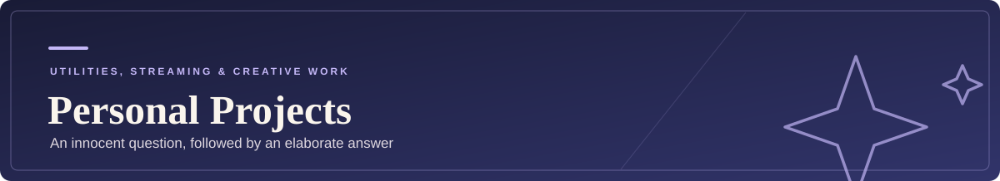

  

  <strong>Curious questions. Very serious engineering. A wildly unreasonable number of side quests.</strong>

  <a href="#-the-short-version">Hello</a> &nbsp;·&nbsp;
  <a href="#-things-ive-used">Toolkit</a> &nbsp;·&nbsp;
  <a href="#-the-things-ive-built">Projects</a> &nbsp;·&nbsp;
  <a href="#-behind-the-scenes">Behind the scenes</a>

---

## ✦ The short version

**Hi, I'm Yingwu! 🦜**

I specialize in making **ridiculously complicated things look suspiciously simple**.

The ideal result? Someone presses a button, everything works, and nobody has to know about the contingency plans, safety checks and weeks of *"okay, but what if this happens?"* behind it.

My projects tend to begin with *"I wonder if that's possible..."* and rapidly become a much larger engineering exercise than originally advertised. Sometimes they're useful. Sometimes they're gloriously silly. Frequently they're both.

## ✦ Things I've used

I've spent years working with software from both sides: **using it to solve real problems**, then improving the workflows around it, and sometimes building something new when the existing tools couldn't quite do the job.

The quick version stays short on purpose. The longer inventory is tucked away for fellow software archaeologists.

| Family | A few familiar faces |
| :--- | :--- |
| ☁️ **Software & Cloud Engineering** | `Cloudflare` · `JavaScript` · `SQL` · `Apps Script` · `GitHub` · `LSL` |
| 📊 **Office, Data & Modelling** | `Excel` · `Microsoft 365` · `Google Workspace` · `VBA` · `Visio` · `Gliffy` |
| 🧾 **Business Systems & Automation** | `Unit4` · `Audition` · `Elvy` · `BPM` · `Moneybird` · `Exact` |
| 🤝 **Workplace & Collaboration** | `Slack` · `Quinyx` · `Discord webhooks` · `Jira` · `Asana` |
| 🎵 **Music & Audio Production** | `3MLE` · `MAGIX Music Maker` · `Guitar Pro 5` · `Audacity` |
| 🎨 **Visual Design & Broadcasting** | `Photopea` · `LunaPic` · `Canva` · `OBS Studio` · `VTube Studio` |
| 📺 **Media & Personal Utilities** | `Plex` · `MusicBee` · `VLC` · `FreeFileSync` · `Spotify` |

<strong>EXPAND THE FULL TOOLKIT · Yes, there really is more</strong>

 

| Family | Software, tools & platforms I've used |
| :--- | :--- |
| ☁️ **Software & Cloud Engineering** | **Cloud:** Cloudflare Workers, Pages, D1, Durable Objects, KV. **Web & scripting:** JavaScript, HTML, CSS, SQL, Google Apps Script, LSL (Second Life's event-driven scripting language). **Editors & delivery:** Notepad++, Visual Studio, GitHub, GitHub Actions. |
| 📊 **Office, Data & Modelling** | **Microsoft ecosystem:** Excel, Word, PowerPoint, Outlook, Teams, OneDrive, Access, Visio, Publisher, Project, Office 365; VBA / Excel macros. **Google ecosystem:** Sheets, Docs, Forms, Slides, Drive. **Reporting & modelling:** Looker Studio, Gliffy, BWise (nested flowchart/process modelling). |
| 🧾 **Business Systems & Automation** | **ERP & bookkeeping:** Unit4 ERP, Moneybird, SAP ERP, AFAS, Exact Globe, Exact Online. **Reporting & business workflows:** Unit4 Audition (linked-code reporting), Unit4 Task Manager / BPM Server (rules and automation). **Document capture & retail:** Elvy (OCR and rule-based document processing), uniCenta oPOS, ETC Domino. |
| 🤝 **Workplace & Collaboration** | **Operations & communication:** Slack, Slack Workflows, Quinyx, Discord webhooks. **Planning, tickets & support:** Jira, Asana, Airtable, Zendesk. **Time tracking:** Kimai. |
| 🎵 **Music & Audio Production** | 3MLE, MAGIX Music Maker, Finale NotePad, Guitar Pro 5, Audacity, MuseScore. |
| 🎨 **Visual Design & Broadcasting** | **Image editing & design:** GIMP, Photopea, LunaPic, Canva. **Broadcast & VTuber:** OBS Studio, VTube Studio, Stream Deck, FugiTech. **Alerts, bots & community:** Streamlabs **Alerts** (not Streamlabs Desktop), Triggerfyre, Streamcord, Fossabot, Nightbot (historical), Ticket Tool, Seen, Twitch.Guru (historical), RankOne. **Viewer interaction, merch & support:** Blerp, Boss Battles, Sound Alerts, Streamloots, FourthWall, Throne, Add to Throne. **Game/stream integration:** Chorus Encore (Clone Hero). |
| 📺 **Media & Personal Utilities** | Plex, MusicBee, VLC Media Player, FreeFileSync, Spotify. **Possibly:** Soundiiz (older music-to-Spotify playlist transfer; exact historical tool still to confirm). |

> [!NOTE]
> **Used, not necessarily mastered — and not necessarily programmed.** An ERP, a music tracker and a programming language are different kinds of experience. This is a practical inventory of software I've worked with, not a collection of proficiency badges. My own projects are showcased separately below.

---

## ✦ The things I've built

**Three project families. Many projects underneath them. A frankly unreasonable number of components below those.**

The hierarchy matters more than the repository count: one private codebase can power numerous independent applications, products and interfaces.

### 01 · StenTeam

**The premise:** day-to-day work should not require a degree in deciphering spreadsheets.

What started as Google Sheets, workplace utilities and manually launched Slack Workflows has grown into **StenTeam Hub Portal (STHP)**: one connected workplace interface designed to make routine operations easier, more consistent and less prone to accidental mistakes.

**The portal at a glance:**

| Area | What it does |
| :--- | :--- |
| **Sheets** | Familiar spreadsheets rebuilt as dedicated, more robust interfaces that help prevent incorrect edits. |
| **Tools** | Practical utilities for everyday workplace tasks. |
| **Workflows** | Existing Slack Workflows launched from the portal via webhooks instead of manually. |

<strong>EXPAND THE STENTEAM HUB PORTAL · 13 modules across 3 areas</strong>

 

| Area | Module | What it does |
| :--- | :--- | :--- |
| **Sheets** | **Lekkerland** | Manage supplier-related operational records. |
| | **Check-in List** | Organize shift check-ins and attendance information. |
| | **Daily Routine** | Keep recurring daily tasks organized. |
| | **Post Delivery Issues** | Record and follow up on delivery issues. |
| **Tools** | **Dashboard** | Present useful operational information in one overview. |
| | **QR Codes** | Create QR codes for everyday workplace use. |
| | **Audit** | Guide and record routine operational checks. |
| | **Print-Outs** | Prepare practical documents for printing. |
| | **To Do** | Organize tasks and follow-up items. |
| | **STQI Status** | View the status of the Quinyx Importer, which uses a Quinyx export to load schedules. |
| | **Bridge** | Connect existing operational records with the portal. |
| **Workflows** | **Red Flags** | Start a Slack workflow to flag issues needing attention. |
| | **Sick Leaves** | Start a Slack workflow for absence reporting. |

Behind the visible modules, supporting applications keep the experience connected. The public overview focuses on **what each module helps people do**, rather than exposing internal processes or implementation details.

### 02 · Azalea Antiquary

**The premise:** virtual worlds should reward curiosity, creativity and the occasional extremely unnecessary level of engineering.

**Azalea Antiquary** is my Second Life creative brand: everything from tiny pieces of deliberate nonsense and practical creator tools to games, web-connected services and a world-scale exploration project.

They may look nothing alike, but each began with a different question about what I could make, what I'd need to learn, and how someone else's experience could be better because of it.

**At a glance:** `Creative experiments` · `Practical scripts` · `Creator tools` · `Interactive games` · `Connected services` · `World exploration`

<strong>EXPLORE AZALEA ANTIQUARY · 11 projects and product collections</strong>

 

| Project / collection | The idea and the challenge |
| :--- | :--- |
| **Cabinet of Minor Nonsense** | A diverse collection of deliberately ridiculous little products that put old-fashioned Second Life conventions to work in surprisingly robust, polished and personal ways. |
| **Commission Works** | Taking the lessons of Creator Desk much further: a web-connected creator system exploring an alternative to one-time sales, with a first product licence included and additional licences for further product launches. Product preparation, packaging and delivery all had to work together coherently. |
| **HUD Systems Collection** | Early experiments in presenting online media inside a convenient on-screen interface. When YouTube embeds wouldn't cooperate, the solution involved a website-based video wrapper instead. |
| **The Inappropriate DJ** | An early creative project from before I could develop my own scripts, using Canva and repurposed Second Life functionality to make something new. |
| **Muffin's Mockery** | Early AI-assisted artwork experiments where the challenge was maintaining a deliberately consistent visual identity across many themed variations. |
| **Scripts** | Practical LSL solutions for very different people and problems, from tiny single-purpose helpers to extensive, interconnected store systems. Includes specialized work such as the #RLV Folderwright. |
| **Trivia Girls** | Starting from a limited trivia script and developing a sturdier, multi-mode experience to discover what makes a game both dependable **and** fun. |
| **Second World** | The flagship collaborative exploration project: combining large-scale geographic data collection, mapping and visualization with shared discovery and the human challenge of understanding what the data actually means. |
| **Dynamic Display** | A deep dive into SVG: using simple shapes to build an extensive catalogue of reusable icons, emblems and components for modular, customizable display signs. |
| **Creator Desk** | Helping creators prepare more consistent products and catch easy-to-miss problems, such as permissions. The experience laid the groundwork for Commission Works. |
| **Parrot's Plunder** | Building an actual interactive game rather than just functional scripted objects, bringing payments, raycasting, dynamic spawning, pickups and hit detection together into enjoyable gameplay. |

**The common thread:** different audiences, constraints and lessons — but always an attempt to make something more useful, more reliable or simply more enjoyable.

**Public example:** [Explore the Second World Collective Atlas](https://yingwuazalea.pages.dev/SecondWorld)

### 03 · Personal Projects

**The premise:** if a better personal tool could exist, why not accidentally build an entire system for it?

A collection of projects for organizing life, tracking interests, supporting streaming and making personal data genuinely usable. Not all of it is public — nor should it be.

**The family at a glance:**

`Media` · `Movies & TV` · `Subscriptions` · `Bowling` · `Streaming catalogue` · `Personal dashboards` · `Yingwu Nova`

<strong>EXPAND PERSONAL PROJECTS · Utilities, streaming and creative work</strong>

 

| Family | Example projects |
| :--- | :--- |
| **Media & collections** | Movies, TV, catalogue and history tools. |
| **Subscriptions & social history** | Personal history and subscription overviews. |
| **Bowling** | Session records, scores, comparisons and progress over time. |
| **Streaming tools** | Streaming catalogue, stream-related utilities and supporting organization. |
| **Personal dashboards** | Small web interfaces that turn complicated personal records into usable views. |
| **Yingwu Nova** | Character identity, VTuber assets, illustrations and an extensive visual design workflow. |
| **Other experiments** | The little tools that usually begin with *"surely this won't be complicated..."* |

**Public example:** [Bowling overview](https://yingwuazalea.pages.dev/yingwu/bowling) · [Social history](https://yingwuazalea.pages.dev/yingwu/social)

> [!WARNING]
> **DATA MISSING — PERSONAL CATALOGUE:** Verify how many distinct streaming tools, media utilities, dashboards and Nova asset families belong here. Identify which are suitable for public description and which must remain private. Confirm whether a public Media demo exists.

> [!WARNING]
> **PUBLIC LINK CHECK REQUIRED:** The Second World, Bowling and Social History URLs above are documented in the project source, but their current availability to an **unauthenticated visitor** has not yet been independently verified for this profile. Check each before treating it as a confirmed public showcase.

---

## ✦ Behind the scenes

### From spreadsheet gremlinry to independent systems

Long before today's AI coding assistants existed, I was already building things.

It often started in **Excel**, then expanded into increasingly elaborate spreadsheets, automations, workflows and tools to solve problems that ordinary software didn't quite handle the way I wanted.

Some of those early solutions were decidedly unconventional. *Gremlin Excel engineering* is probably a fair description. But the underlying habit was already there: understand the problem, design something practical, keep improving it and make it useful for the people actually doing the work.

My background in **administrative organization and internal control (AO/IC)**, writing manuals, training colleagues and day-to-day operations shaped a central rule: **never assume the person using a tool knows what its designer knows**. The people using software should not have to think like the person who built it. When something looks easy, that is often the result of very deliberate engineering.

> [!WARNING]
> **DATA MISSING — THE HUMAN STORY:** Fill in the approved public version of my work history, years of spreadsheet/automation experience, online history, creative interests and personal background. **Do not publish employer identifiers, personal records or other private-life details by guesswork.**

### How I actually build things

**1 · "I wonder..."** — An innocent question leads to research, experiments and a surprising number of possibilities.

**2 · Decide what should happen.** — I compare options, trade-offs, constraints and real user needs before deciding how anything should behave.

**3 · Explore what could go wrong.** — Timeouts, bad data, wrong roles, stale information, partial failures, accidental repeat actions, unavailable external services and humans doing wonderfully unpredictable things all deserve an answer.

**4 · Build for people, not for the machinery.** — The interface should feel obvious. The complicated machinery belongs backstage.

**5 · Test, refine, repeat.** — Sometimes the right solution emerges quickly. Sometimes it takes hours of back-and-forth and hundreds of small improvements.

**6 · Make it survive its own creation.** — Versioning, documentation, careful handovers, rollback plans and self-sufficient operation matter. A system shouldn't need its designer present every time somebody clicks a button.

### AI-assisted development ≠ one-prompt software

**I use ChatGPT extensively as a development collaborator. I also remain responsible for the software's intent, architecture, requirements, decisions and acceptance criteria.**

I'm comfortable thinking in systems, understanding what computers need to do and identifying what isn't robust enough. Writing large amounts of programming syntax by hand has never been the quickest part of that process for me.

AI is genuinely valuable here: we research ideas together, debate options, translate detailed specifications into code, diagnose unexpected behavior, design tests and document what we've learned. It deserves credit for that work.

But these projects are not *"write me an app"* followed by blind deployment. There is often a long, precise discussion of **what should happen when X fails, when Y changes, when two people act at once, or when data is missing** — and the answer must match the intended behavior, not just produce something that looks plausible.

**Security, privacy and operational independence are part of the design, not finishing touches.** During development I favor anonymized examples, clear permission boundaries, least-privilege access, verification of data and role handling, and avoiding the unnecessary exposure of personal information. Software should depend on validated rules and capabilities, not on hard-coded knowledge of specific people.

The resulting day-to-day tools are meant to run **without needing an ongoing chat with an AI assistant or their creator on standby**. Separate research experiments may explore AI, but that is not the operating model of the everyday systems.

> **In short:** I design what the system must be, invest serious effort in understanding how it can fail, and use AI to help implement and refine it. The achievement is not generating code quickly; it's making the result dependable.

---

  <strong>Curiosity gets it started. The contingency plans make it worth using.</strong> 
  Portfolio profile in active curation · Private source repositories stay private.

<!-- FINAL PORTFOLIO CLEANUP: Once all missing-data warnings are resolved and the public inventory is verified, remove the UNDER CONSTRUCTION text from the banner artwork as the LAST finishing step. Preserve the approved banner design; replace only that notice. -->
